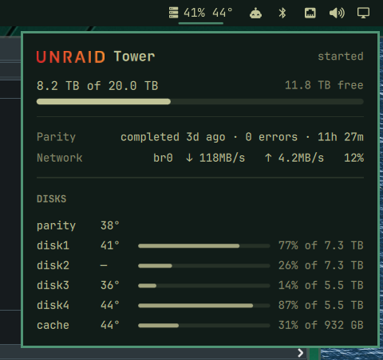

# omarchy-unraid

Unraid server status in the [Omarchy](https://omarchy.org) 4 bar: capacity, disk
temperatures, parity, and network throughput.



The bar shows array fill and a disk temperature. Clicking opens a panel with
capacity, parity status, network rate, and every disk in the array.

| Bar | Meaning |
|---|---|
| `󰒋 41% 44°` | Healthy: fill percentage and a disk temperature |
| `󰒋 parity 34%` | Parity check in progress |
| `󰒋 setup` | No `host` configured |
| `󰀦 41% 58°` | A disk is over its temperature threshold |
| `󰀦 stopped` | Array is not started |
| `󰀦 offline` | Server unreachable |
| `󰀦 key` | API key file missing or unreadable |
| `󰀦 api` | Server rejected the query |

The urgent color means something needs attention; `󰀦` marks the critical cases.
The temperature shown is whichever disk is furthest over *its own* threshold,
falling back to the hottest disk when none are over. Spinning disks and SSDs
have separate limits.

## Requirements

- Omarchy 4.x
- Unraid 7.x with the API enabled
- `curl`

## Install

```bash
omarchy plugin add https://github.com/awangk/omarchy-unraid.git --enable --yes
```

Plugins run as unsandboxed QML inside `omarchy-shell`. Without `--enable` the
plugin installs disabled so you can read it first.

By hand:

```bash
git clone https://github.com/awangk/omarchy-unraid.git \
  ~/.config/omarchy/plugins/awangk.unraid
omarchy-shell shell rescanPlugins
omarchy plugin enable awangk.unraid --section right
```

## API key

Create one under **Settings → Management Access → API Keys → Add Key** and grant
read on:

| Resource | Needed for |
|---|---|
| `ARRAY` | Array state, capacity, disks, parity. Required. |
| `VARS` | Server name in the panel header |
| `INFO` | Network transfer rate |

A key without `VARS` or `INFO` still works. The widget drops whichever field it
is refused, keeps polling the rest, and re-checks every 15 minutes.

The CLI equivalent:

```bash
unraid-api apikey --create --name omarchybar --roles guest \
  --permissions "array:read:any,vars:read:any,info:read:any"
```

Three things to know about it:

- Names accept only letters, digits and spaces. `omarchy-bar` is rejected.
- `--roles` is required even for a permissions-only key, or the save fails with
  `Invalid data structure`. `guest` grants nothing beyond your own profile.
- `--overwrite` changes permissions on an existing key without rotating the
  secret.

## Store the key

```bash
install -m 600 /dev/null ~/.config/omarchy/unraid-api-key
read -rs -p 'Unraid API key: ' key && printf '%s' "$key" > ~/.config/omarchy/unraid-api-key
unset key
```

The poll script reads the file and passes the header to curl over stdin, so the
key never appears in `argv` or `/proc`. Over plain `http://` it still crosses the
network in cleartext on every poll, so prefer `https://`.

## Configure

Set `host` on the widget's entry in `~/.config/omarchy/shell.json`:

```json
{ "id": "awangk.unraid", "host": "https://tower.local" }
```

Settings hot-reload; no restart needed.

## Settings

All optional except `host`, set inline on the widget's `shell.json` entry.

| Key | Default | Meaning |
|---|---|---|
| `host` | — | Server base URL |
| `apiKeyFile` | `~/.config/omarchy/unraid-api-key` | File holding the key |
| `refreshIntervalSec` | `30` | Poll interval with the panel closed (5–3600) |
| `openRefreshIntervalSec` | `2` | Poll interval with the panel open (1–60) |
| `insecure` | `false` | Skip TLS verification, for a self-signed certificate |
| `tempWarn` / `tempCrit` | `45` / `55` | Spinning-disk thresholds (°C) |
| `ssdTempWarn` / `ssdTempCrit` | `60` / `70` | Non-rotational disk thresholds (°C) |
| `capacityWarn` / `capacityCrit` | `85` / `95` | Array fill thresholds (%) |
| `showCapacity` | `true` | Fill percentage in the bar |
| `showTemp` | `true` | Disk temperature in the bar |
| `showNetwork` | `true` | Network rate in the panel. Needs `INFO`. |
| `showNetworkInBar` | `false` | Network rate in the bar as well, fixed-width |
| `netInterface` | `""` | Pin an interface. Blank picks the busiest non-virtual one. |
| `label` | `""` | Prefix, for telling two servers apart |

`allowMultiple` is on, so a second entry with its own `host` and `label` adds a
second server to the bar.

`insecure` disables certificate verification entirely, which makes the
connection interceptable. It is a stopgap for a self-signed certificate on a
trusted LAN, not a fix.

## Interactions

| Input | Action |
|---|---|
| Left click | Open the panel |
| Right click | Open the Unraid web UI |
| Middle click | Poll now, and retry any permission that was refused |
| Esc | Close the panel |

## Troubleshooting

**Network row says `needs INFO on the API key`.** Add `INFO` read to the key,
then middle-click the widget.

**Network row says `no interface named …`.** `netInterface` names an interface
the server does not have. Fix the typo or clear the setting.

**No rate in the bar.** By design; set `showNetworkInBar` to `true`. The panel
always shows it.

**`󰀦 offline`.** Check `host` and that the server is reachable. The panel shows
curl's exit code and stderr.

**Widget disappeared after an edit.** Check `journalctl --user -e` for QML
errors. A stale compiled-QML cache reports `File name case mismatch`; clear it
with `rm -rf ~/.cache/quickshell` and run `omarchy restart shell`.

## Development

`Model.js` has no QML dependencies, so the parsing and formatting run under
plain node:

```bash
node test/model-test.js
```

`UnraidPanel.qml` hot-reloads on save. `Model.js` does not, because the QML
engine caches imported JS; run `omarchy restart shell` after changing it.

The entry point is `UnraidPanel.qml` rather than `Panel.qml`, which would shadow
`qs.Ui`'s own `Panel` type and stop the plugin loading.

## License

MIT, see [LICENSE](LICENSE).

`unraid-logotype.svg` is the Unraid wordmark, a trademark of Lime Technology,
Inc., reproduced to identify the server this widget reports on. It is not
covered by the MIT license. This project is not affiliated with, sponsored by,
or endorsed by Lime Technology, Inc.
